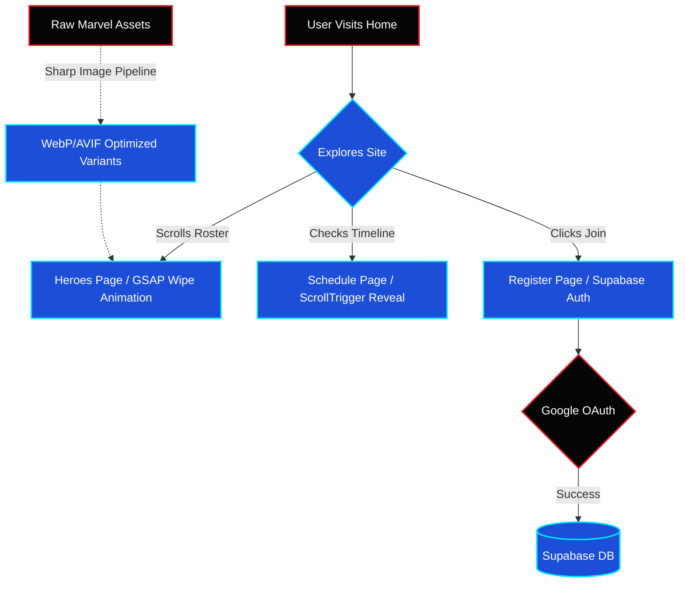

<div align="center">
  
  
  
  
  
</div>

<h1 align="center">🕷️ GeeksForGeeks: Into the Spider-Verse</h1>

<p align="center">
  A premium, cinematic Marvel-themed event website built for the GeeksForGeeks Student Chapter (Bennett University) — Junior Core Round 1.
</p>

---

## 🎬 Concept & Vision

The site is built around **"The Avengers Roster"** theme, functioning more like an interactive movie trailer than a static event page. It features full-viewport, scroll-stitched hero introductions with custom **GSAP** transitions, a buttery smooth scrolling experience via **Lenis**, and heavily optimized responsive imagery that refuses to stretch or break on any device.

## 🏗️ Architecture Flowchart



## ⚡ Tech Stack Highlights
- **Framework:** Next.js (App Router) + TypeScript
- **Styling:** Tailwind CSS v4 (Glassmorphism & Cinematic Typography)
- **Animation:** GSAP (ScrollTrigger) + Lenis (Smooth Scroll)
- **Auth & Database:** Supabase (Google OAuth Integrated)
- **Image Pipeline:** Node + Sharp (Automated WebP/AVIF generation at multiple breakpoints mapping to `manifest.json`)

---

## 🚀 Vercel Deployment Ready
This repository is **100% strictly typed** and has passed a local `npm run build` with **0 errors**. It is ready for one-click deployment on Vercel. 

### Deployment Checklist:
1. Connect your GitHub Repo to Vercel.
2. In the Vercel **Environment Variables** settings, add:
   - `NEXT_PUBLIC_SUPABASE_URL`
   - `NEXT_PUBLIC_SUPABASE_ANON_KEY`
3. Click **Deploy**. Vercel will automatically build the site using `npm run build`.

---

## 💻 How to Run Locally

1. Clone the repository.
2. Install dependencies:
   ```bash
   npm install
   ```
3. Set up your environment variables by creating a `.env.local` file in the root:
   ```env
   NEXT_PUBLIC_SUPABASE_URL=your_supabase_project_url
   NEXT_PUBLIC_SUPABASE_ANON_KEY=your_supabase_anon_key
   ```
4. Start the development server:
   ```bash
   npm run dev
   ```
5. Open [http://localhost:3000](http://localhost:3000)

## 🏆 Submission Blurb
*"GeeksForGeeks: Into the Spider-Verse is a cinematic, scroll-driven event platform built with Next.js and GSAP. Moving away from standard template layouts, it stitches together full-bleed interactive character sections into a seamless trailer-like experience. Complete with a robust responsive image pipeline and Supabase Google OAuth, the architecture balances extreme visual polish with strict performance best practices."*
